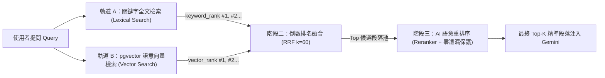

# 模組 6 實施計劃：混合搜索與重排序（Hybrid Search + RRF + Reranking）

## 1. 為什麼僅靠向量搜索（Vector Search）不夠？
在真實世界的 RAG 應用中：
- **向量檢索（Dense Vector Search）的強項與盲點**：
  - 強項：擅長理解「同義詞與概念」（例如問「幾點集合領獎？」，能找到「受獎社友請於 08:10 報到」）。
  - 盲點：對於**專有名詞、人名、社團名稱、編號或特定獎項**（例如「松青社」、「民生社」、「林啟平」、「阿奇·柯藍夫」），高維度Embedding向量常把所有「扶輪社得獎名單」視為語意相近（相似度都在 80% 左右），導致真正包含「民生社」的段落可能排在第 15 名而被遺漏。
- **關鍵字全文檢索（Lexical / Keyword Search）的強項與盲點**：
  - 強項：對專有名詞、人名、社名、精確字詞 **100% 零誤差命中**。
  - 盲點：不懂同義詞與語意概念。

因此，生產級 RAG 系統必須採用 **「混合搜索（Hybrid Search）＋ 倒數排名融合（RRF）＋ AI 重排序（Reranking）」** 三階段黃金架構！

---

## 2. 三階段檢索架構設計（`backend/app/services/hybrid_search.py`）

### 第一階段：雙軌並行檢索（Dual-Track Retrieval）
1. **軌道 A — 關鍵字檢索（Lexical Search）**：
   - 提取核心專有名詞與關鍵字，透過資料庫查詢與詞頻密度（TF / 行命中數）計算排名 `keyword_rank`（第 1 名、第 2 名...），並自動標註「⚡關鍵字精準命中行」。
2. **軌道 B — 稠密向量檢索（Dense Vector Search）**：
   - 將問題透過 `gemini-embedding-001` 轉為 768 維度向量，呼叫 Supabase `match_document_chunks` 計算餘弦相似度（Cosine Similarity），得出排名 `vector_rank`（第 1 名、第 2 名...）。

### 第二階段：倒數排名融合（RRF — Reciprocal Rank Fusion）
- 由於「關鍵字命中數」與「向量餘弦相似度（0~1）」量綱不同，不能直接相加，因此使用業界標準的 **RRF 公式**：
  $$\text{RRF\_Score}(d) = \frac{w_{\text{kw}}}{k + \text{rank}_{\text{kw}}(d)} + \frac{w_{\text{vec}}}{k + \text{rank}_{\text{vec}}(d)} \quad (k = 60)$$
- 若某個段落同時被「關鍵字軌道」與「向量軌道」命中（`match_type = "hybrid"`），其 RRF 分數會雙重疊加並躍升至最前面！

### 第三階段：AI 精準重排序（Reranking + 專有名詞零遺漏保護）
- 將 RRF 融合後的候選段落交由 **Reranker（基於 Gemini + Pydantic `RerankScoreSchema` 與語意交叉比對）** 進行二次精準評分（`rerank_score: 0.0 ~ 1.0`）。
- **零遺漏保護機制（Zero-Omission Guard）**：凡是包含使用者指定專有名詞（如社名、人名）的關鍵字命中段落，強制保留於最終結果中並給予最高優先級，同時自動過濾掉「向量相似度看似不低、但實際在講別的社團」的干擾段落！

---

## 3. 前端視覺化升級（`ChatView.tsx` & `App.tsx`）
- 在聊天室展開「已從知識庫檢索 X 個相關段落」時，為每個段落顯示完整的 **模組 6 混合檢索與重排序徽章**：
  - **命中類型**：`🔥 雙軌命中 (關鍵字+向量)` / `🎯 關鍵字命中` / `🧠 向量語意命中`
  - **RRF 排名明細**：`關鍵字 #1` · `向量 #3` · `RRF: 0.0325`
  - **Rerank 最終精準度**：`✨ Rerank 分數: 99.2%`
