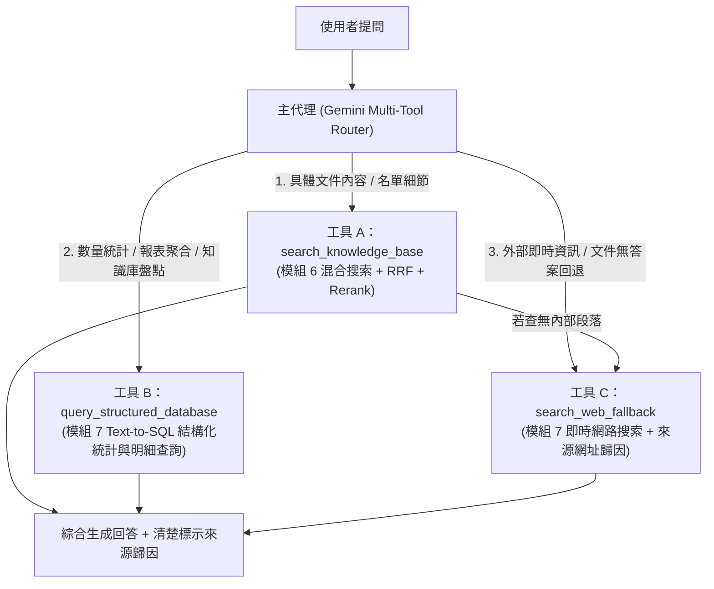

# 模組 7 實施計劃：附加工具（多工具代理：Text-to-SQL 結構化數據查詢 ＋ 網路搜索回退 Web Search Fallback）

## 1. 模組目標與核心學習概念
在前面的模組 1～6 中，我們的 Agent 已經具備強大的「非結構化文件檢索能力」（混合搜索 + RRF + AI 重排序）。但在真實企業與扶輪社務場景中，使用者常會提出另外兩類問題，單靠向量/段落檢索無法完美解決：

1. **結構化統計與聚合問題（Structured Data / Text-to-SQL 場景）**：
   - 例如：「知識庫目前共有幾份文件？各分類有幾份？總共有幾個向量分塊？」或「幫我統計《2026地區年會三全四全頒獎名單》中，各分區或各社的得獎筆數排行？」
   - 若只撈取 Top-8 段落，AI 無法算出整份文件的總筆數或跨文件統計。這時需要 **Text-to-SQL / 結構化數據查詢工具（`query_structured_database`）**。
2. **外部即時資訊與知識庫無答案時的回退（Web Search Fallback 場景）**：
   - 例如：「請問國際扶輪（Rotary International）2025-26 年度主題是什麼？」或「今天台灣最新科技新聞是什麼？」
   - 當問題超出私有文件範圍，或 `search_knowledge_base` 找不到結果時，Agent 必須優雅回退（Graceful Fallback）至 **即時網路搜索工具（`search_web_fallback`）**，並清楚標註「📄 內部知識庫來源」與「🌐 外部網路搜尋來源」以建立可信度歸因（Attribution for Trust）。

> 💡 **備註**：根據 `PRD.md` 規劃，**模組 7** 專注於「附加工具（Text-to-SQL 結構化查詢 ＋ 網路搜索回退）」，而緊接著的 **模組 8** 則會實作「子代理（Sub-Agents — 具備獨立隔離上下文的全文件深度分析代理與階層式推理展示）」。

---

## 2. 多工具代理路由架構（Multi-Tool Agent Routing）

---

## 3. 後端實作設計（`backend/app/services/additional_tools.py`）

1. **工具 B：`query_structured_database`（Text-to-SQL 結構化數據與統計查詢）**
   - 使用 Pydantic `StructuredQueryPlanSchema` 讓 Gemini 將自然語言問題轉譯為安全的結構化查詢計劃（支援：
     - `knowledge_base_overview`：查詢 `documents` 與 `document_chunks` 統計表，列出每份文件的標題、AI 分類、年份、SHA-256、分塊數、字元數等完整結構化清單。
     - `document_table_aggregation`：針對已導入文件中的結構化 Markdown 表格列（例如年會頒獎名單的每一列資料）執行 SQL 風格的條件篩選、`GROUP BY` 分組計數與關鍵字彙總統計）。
   - 回傳結構化查詢結果與自動生成的等效 SQL 語句（方便使用者在前端清楚看見 Text-to-SQL 的轉換過程）。

2. **工具 C：`search_web_fallback`（即時網路搜索回退）**
   - 支援免額外付費金鑰的即時網路搜尋引擎（結合 DuckDuckGo HTML/Lite 搜尋與 Google News RSS 中文即時新聞檢索，並自動清理 HTML 擷取標題、摘要與真實 URL）。
   - 當：
     1. 使用者詢問外部世界/即時資訊，Agent 直接呼叫 `search_web_fallback`；或
     2. Agent 呼叫 `search_knowledge_base` 後發現內部知識庫 `0` 筆命中時，系統**自動觸發優雅回退（Auto Web Fallback）**改查網路，並清楚告知使用者哪些資訊來自內部文件、哪些來自外部網路。

---

## 4. 前端視覺化升級（`ChatView.tsx` & `App.tsx`）
- 升級頂部徽章為 **`模組 7：附加工具 (Text-to-SQL + 網路搜索回退)`**。
- 在聊天室訊息上方的工具調用卡片中，根據使用的工具顯示專屬視覺徽章與明細：
  - 📚 **知識庫混合檢索（`search_knowledge_base`）**：顯示雙軌命中、RRF 與 Rerank 精準度。
  - 🗄️ **Text-to-SQL 結構化數據查詢（`query_structured_database`）**：顯示生成的 SQL 語句區塊與結構化統計結果。
  - 🌐 **網路搜索回退（`search_web_fallback`）**：顯示外部網頁標題、摘要與可點擊的真實來源網址連結。
